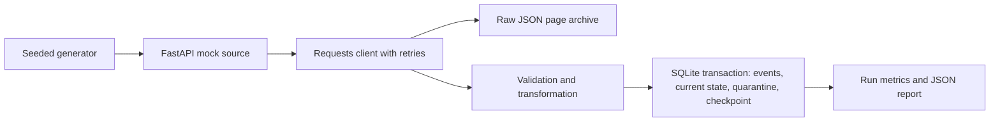

# Architecture

Each page response is written to a raw JSON file before validation. Target changes, quarantines, and next-page checkpoint commit together. The file and database cannot share one atomic transaction: if a process stops after raw-file write, a restart re-fetches the uncommitted page and may leave an extra raw copy. Page-number checkpoints require a stable upstream snapshot; changing page contents between requests can shift records. The mock dataset is deterministic. Production sources should use snapshot tokens or stable opaque cursors.
